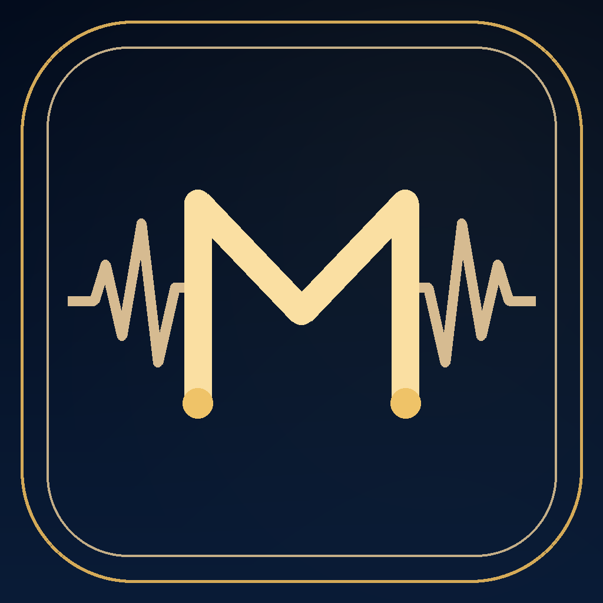
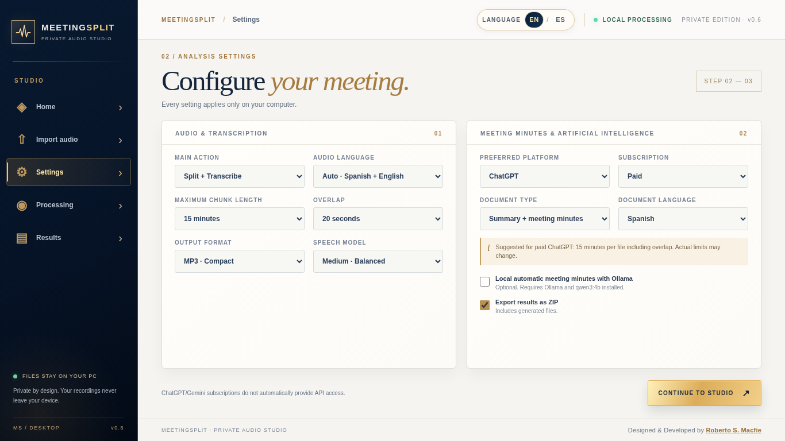
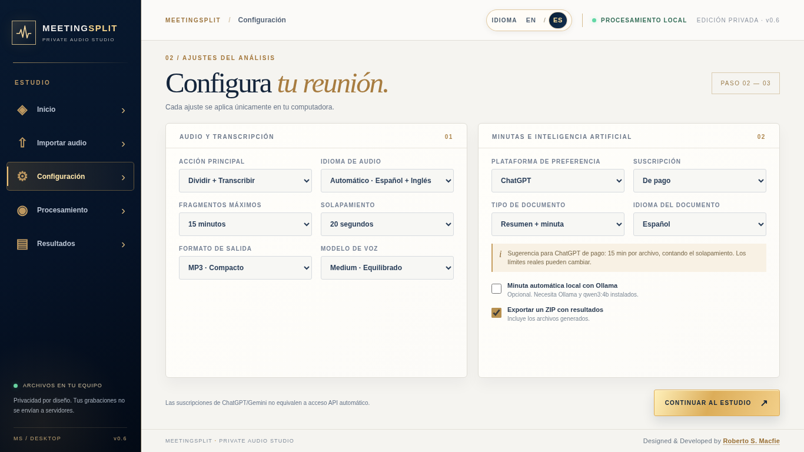

<div align="center">



# MeetingSplit

### Your meetings, precisely captured.

**A premium, privacy-first Windows application for intelligent audio splitting, local transcription, and structured meeting notes.**

**English · Español · Mixed-language recordings**

[Overview](#overview) · [Preview](#preview) · [Features](#features) · [Getting started](#getting-started) · [Development](#development) · [Español](#español)

</div>

> [!IMPORTANT]
> **Development build · v0.8.4 · Not a production release.** The source is under active development. GitHub Actions generated an installer, but an ASUS test of v0.8.3 identified a CUDA library failure and an internal D: detection problem. The v0.8.4 corrections still require Windows hardware validation. Please do not process confidential recordings until the Windows build and privacy checks are complete.

---

## Windows storage and NVIDIA runtime (development v0.8.4)

The app accepts folders on **verified internal C: or D:** drives, and deliberately refuses USB/removable/network targets and folders inside OneDrive, Google Drive, Dropbox or iCloud Drive. In Windows, choose a non-synced folder such as `C:\MeetingSplit` (if writable), or a directory under `%LOCALAPPDATA%`. D: is verified using Windows Storage with a CIM fallback for systems where `Get-Disk` reports an unavailable bus type. Unknown physical connections remain blocked for safety.

NVIDIA GPU transcription with Faster-Whisper requires **CUDA 12 cuBLAS and compatible cuDNN 9 libraries** available to the app, not merely a GPU driver. MeetingSplit now checks the DLLs before using CUDA, and retries on CPU if CUDA fails at runtime; CPU processing may be considerably slower. CUDA DLLs are not bundled into the application without a license and packaging review. Do not download DLLs from untrusted websites. Test with a disposable, consented short recording before processing real meetings.

## Overview

MeetingSplit helps turn long recordings into manageable, verifiable information. It is designed for meetings of roughly **one to three hours**, including conversations that switch between English and Spanish.

1. **Import** a recording from your computer or a locally available file synced from iCloud Drive or Google Drive.
2. **Split** it into AI-friendly segments using speech/silence boundaries, safety overlap, and coverage checks.
3. **Transcribe locally** using Faster-Whisper, with optional NVIDIA GPU acceleration and a CPU fallback.
4. **Export** audio parts, a timestamped transcript, subtitles, and structured prompts for ChatGPT or Gemini.
5. **Prepare a summary and/or minutes** using an optional locally running language model, or by taking the exported results to your existing AI subscriptions.

MeetingSplit **does not require a cloud account for the audio processing engine**. Models may need to be downloaded on first use. Sending content to ChatGPT or Gemini is a separate, user-initiated action.

## Preview

Real screenshots of the development interface, not mockups:

| English — default interface | Español — selectable interface |
| :---: | :---: |
|  |  |

**Design direction:** cinematic navy and warm gold, high-density visual assets, crisp typography, five individual screens rather than a long scrolling page. The display language preference persists independently of transcript and report language preferences.

### Five dedicated screens

`Home` · `Import` · `Settings` · `Processing` · `Results`

## Features

| Capability | Current source status |
| --- | --- |
| Native Windows interface (PySide6 + Qt WebEngine) | Implemented in source; native QA pending |
| English interface by default, switchable to Spanish | Implemented; browser/UI tests completed |
| Independent screens and permanent developer credit | Implemented; browser/UI tests completed |
| Import MP3, M4A, WAV and other FFmpeg-supported formats | Implemented; format-dependent validation pending |
| Silence-aware splitting, bounded overlap and coverage manifest | Implemented; engine tests completed |
| Local transcription with Faster-Whisper | Integrated; real bilingual GPU/CPU validation pending |
| TXT, JSON, SRT, audio chunks and ZIP export | Implemented; integration tests completed |
| Optional local summary / meeting minutes via Ollama | Integrated; quality validation pending |
| ChatGPT/Gemini preparation and prompts | Implemented; **no direct paid-plan API assumption** |
| Choose a local data folder per computer | Implemented; Windows drive detection QA pending |
| Windows portable build / installer recipe | Prepared; **no verified `.exe` yet** |

### Bilingual by design

The language switch changes **the application interface**, not the recording language. Audio may contain Spanish, English, or both. Transcript and output-document language are separate settings.

### Privacy and storage

- Meetings are processed locally; no MeetingSplit server receives the recordings.
- The original audio file is left unchanged.
- Users choose where local models, temporary files, transcriptions, and results are stored.
- Removable USB drives and cloud-synced locations are not intended as automatic output destinations; users can still **import** recordings from synced folders.
- Initial model downloads and any explicitly opened external links require Internet access.
- Third-party AI services receive meeting content **only if the user chooses to upload it**.

> Obtain permission from meeting participants where required by applicable law before recording or processing conversations.

## Getting started

### For future end users

A verified Windows installer **has not been published**. When testing and release checks are complete, installation instructions and a signed/reviewed release artifact will be added here. Do not confuse the source ZIP or HTML preview with an installable program.

### For developers and testers

**Requirements:** Windows 11 x64, Python 3.11 (recommended), FFmpeg + FFprobe, and the dependencies in [`requirements.txt`](requirements.txt). NVIDIA GPU is optional. Inno Setup is optional for installer packaging.

```powershell
# In the repository root — prepare a local development environment
.\scripts\instalar.bat

# Ensure FFmpeg and FFprobe are available in bin\ or on PATH
.\scripts\diagnostico_windows.bat

# Run the development desktop application
.\scripts\abrir.bat
```

After installing the dependencies, the self-check can also be run without opening any meeting:

```powershell
.\.venv\Scripts\python.exe run.py --self-check diagnostics.json
```

Building a Windows executable: read [`COMPILACION_WINDOWS.md`](COMPILACION_WINDOWS.md) before running `scripts\compilar_windows.bat`.

### GitHub Actions

The project includes [a manually triggered Windows build workflow](.github/workflows/windows-build.yml) (`workflow_dispatch`). The workflow is a **build/test aid, not evidence that the installer works on the target PC**. Release packaging, third-party license notices, executable verification, privacy review, and hardware QA remain gates before distribution.

## Development

```text
MeetingSplit/
├── .github/workflows/   # Opt-in Windows build
├── assets/              # Application icon and authentic screenshots
├── desktop/             # Qt desktop window, local storage, diagnostics
├── engine/              # Audio, splitting, transcription, exports, reports
├── ui/                  # Luxury bilingual desktop interface
├── scripts/             # Development and Windows packaging helpers
├── tests/               # Engine, interface, limits and packaging checks
├── run.py               # Native app entry point
├── requirements.txt
├── MASTER_STATUS.md     # Latest validated checkpoint
└── COMPILACION_WINDOWS.md
```

The v0.7 baseline checkpoint reported **29 tests passing in separate groups on Linux**. It does not establish validation of a Windows executable, real NVIDIA transcription, diarization accuracy, or the quality of a three-hour meeting summary.

**Next milestones:** build Windows artifacts → validate on Windows 11 → verify FFmpeg/Qt components → test bilingual transcription and CPU fallback → run long-meeting reliability and privacy checks → prepare a reviewed release.

For the current engineering status, see [`MASTER_STATUS.md`](MASTER_STATUS.md).


## Free to use · Voluntary support

MeetingSplit is **free to use**. **No donation is required** to access its features. A discrete **Support Development / Apoyar el desarrollo** button opens the owner's PayPal-hosted support button **in the system browser, only after the user clicks**. The local audio interface never loads the PayPal SDK. Payment requires Internet, but local audio processing does not.

- Support opens the official PayPal contribution URL directly in the external browser, only after a user click. No PayPal SDK or card collection is loaded inside MeetingSplit.
- Contributions are **optional and not charitable tax-deductible donations**. PayPal transaction fees may apply.
- **GitHub Sponsors** may be added later when an official sponsorship link exists; Ko-fi is not required.
- Free personal, educational, church, nonprofit, and internal business use is allowed under the custom [MeetingSplit Freeware License](LICENSE). This is **not an open-source license**; redistribution and resale of the Software require permission.
- [How support works (EN/ES)](docs/VOLUNTARY_SUPPORT.md)

**Designed & Developed by Roberto S. Macfie**  
© 2026 Roberto S. Macfie. All rights reserved.

### Español — Programa gratuito y aportaciones voluntarias

MeetingSplit se distribuye gratis. El botón **Apoyar el desarrollo** abre la página del botón oficial de PayPal en tu navegador habitual, solo si decides pulsarlo. Nunca se exige pagar para usar la aplicación y los audios siguen procesándose localmente. Las aportaciones no son donaciones benéficas deducibles de impuestos.

---

## Español

<details>
<summary><strong>Leer resumen e instrucciones en español</strong></summary>

### ¿Qué es MeetingSplit?

MeetingSplit es una aplicación de escritorio para **Windows 11** que divide grabaciones extensas mediante pausas inteligentes, las transcribe localmente y prepara archivos para crear resúmenes y minutas. Está diseñada para reuniones en español, inglés o ambos idiomas.

**No es una página web ni un servicio de suscripción.** La aplicación trabaja sobre archivos locales y utiliza el disco de cada computadora. Importar una grabación desde una carpeta sincronizada es diferente de subir sus resultados a Internet.

### ¿Qué incluye el código actual?

- Cinco pantallas individuales: Inicio, Importar, Configuración, Procesamiento y Resultados.
- Selector **English / Español** visible en la interfaz, con inglés predeterminado.
- Selección de carpeta de datos por equipo, compatible con computadoras de uno o varios discos internos.
- Cortes inteligentes con solapamiento y verificación de cobertura.
- Transcripción local con Faster-Whisper y aceleración NVIDIA opcional.
- Exportación de audio, transcripción TXT/JSON, subtítulos SRT y ZIP.
- Preparación para ChatGPT/Gemini y generación local opcional de resúmenes/minutas mediante Ollama.

### ¿Ya puedo instalarlo?

**Todavía no hay un instalador `.exe` verificado.** La versión v0.7 es código en desarrollo. Los resultados y capturas no reemplazan las pruebas reales en Windows 11. Para compilar, consulta [`COMPILACION_WINDOWS.md`](COMPILACION_WINDOWS.md).

### Privacidad

El motor de audio no necesita subir las grabaciones a servidores de MeetingSplit. Los modelos pueden requerir descarga inicial. Si decides enviar audios o transcripciones a ChatGPT o Gemini, se aplican las condiciones de esos servicios.

</details>

## Licensing and third-party software

**MeetingSplit Freeware License:** See the full terms in [`LICENSE`](LICENSE). The application is free to download and use for personal, educational, church, nonprofit, and internal business purposes. Voluntary PayPal contributions are optional. The custom license restricts republishing, redistribution, resale of MeetingSplit itself, and distribution of modified versions without written permission. Public visibility of source code does **not** make this an OSI-approved open-source project.

**Licencia de uso gratuito (español):** puedes descargar e instalar MeetingSplit gratis y utilizarlo en casa, en la iglesia, en estudios o dentro de una empresa. Las aportaciones son voluntarias. No se autoriza vender el software, redistribuirlo ni publicar versiones modificadas sin permiso escrito. Consulta los términos completos (en inglés) en [`LICENSE`](LICENSE).

This project depends on software with **separate licenses** (including Qt/PySide6, Faster-Whisper, FFmpeg, and any downloaded AI models). A distribution must audit and comply with the exact dependencies, codecs, build variants, and model licenses it ships. No bundled third-party license review has yet been signed off.

---

<div align="center">

**Designed & Developed by Roberto S. Macfie**

<sub>MeetingSplit · Independent Windows desktop software · Development version 0.8.4</sub>

</div>

### Direct support link

The optional **Support Development** control opens [https://www.paypal.com/ncp/payment/XPUK3HVHJW8KE](https://www.paypal.com/ncp/payment/XPUK3HVHJW8KE) in the user's default browser. Payments are handled by PayPal, not MeetingSplit.
